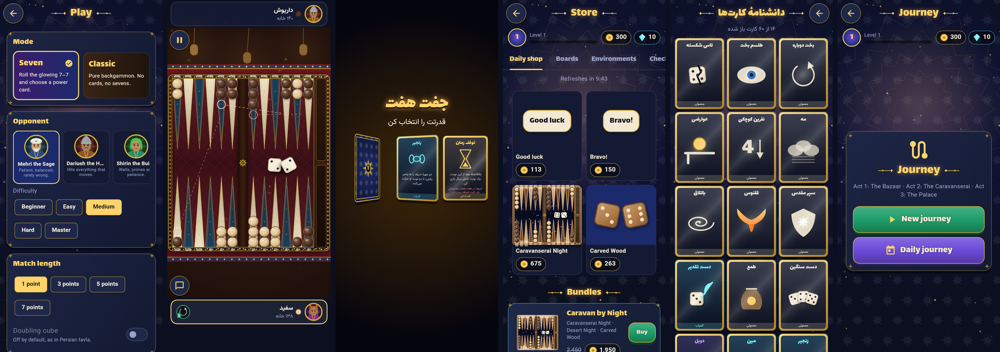
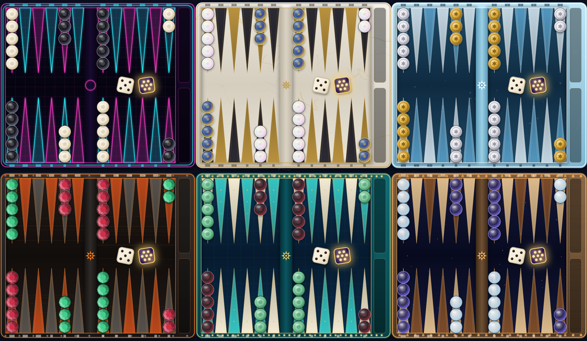
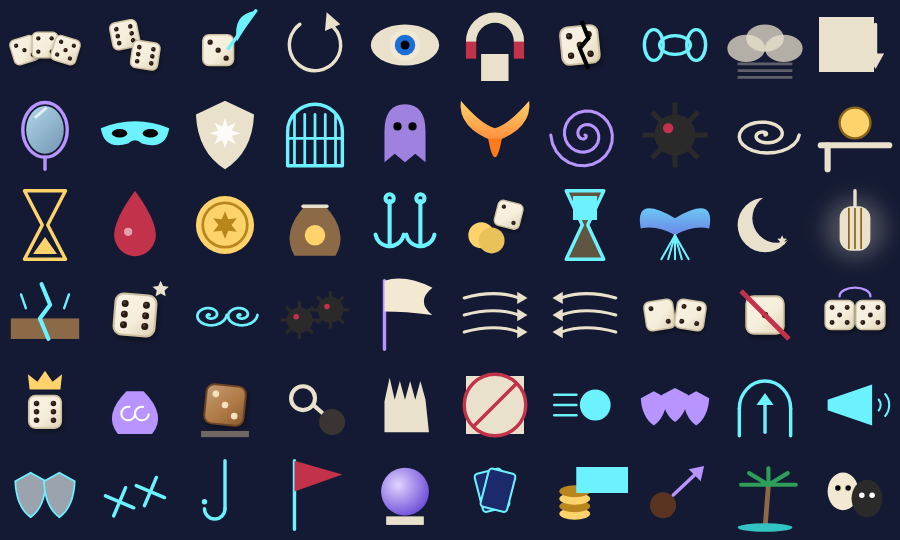

# HaftNard · هفت‌نرد

A roguelike take on Persian backgammon (Takhte Nard) for Android, built with
Flutter + Flame. At its heart it is exact, classic backgammon. The twist: the
dice can roll a glowing **Double Seven (7–7)**. When that happens the game
freezes and you pick one of three power cards — loaded dice, chains, landmines,
time stop — Balatro-style.



| Board themes | All 60 power cards |
| --- | --- |
|  |  |

## Content
60 power cards · 40 Journey talismans · 15 bosses · 5 AI personalities × 5
difficulties · 9 boards · 7 living environments · 9 checker sets · 7 dice ·
card backs, frames, victory effects, emotes · 33 achievements · full Persian
(RTL) and English localization. Every image and sound is generated by code.

## Modes
- **Classic (کلاسیک)** — pure backgammon vs AI or pass-and-play.
- **Seven (هفت)** — classic plus the 7–7 card system.
- **Journey (سفر)** — a roguelike run of opponents across three acts with bosses,
  talismans and a run shop. Seeded runs and a daily seed.
- **Pass & Play (دو نفره)** — two players, one device.

## Building
Everything builds from this repository alone — no secrets, accounts or
downloaded assets are needed.

```bash
flutter pub get
flutter analyze
flutter test
flutter build apk --release
```

CI (`.github/workflows/ci.yml`) analyzes, tests and builds a release APK and AAB
on every push; pushing a `v*` tag also publishes a GitHub Release. See
[`docs/RELEASE.md`](docs/RELEASE.md) for adding a real signing key.

## Tools
- `dart run tool/simulate.dart --games 2000` — headless AI-vs-AI balance runs,
  reports go to `docs/balance/`.
- `dart run tool/gen_sfx.dart` — regenerates the procedural sound effects in
  `assets/audio/`.
- `tool/check.sh` — the same gates CI runs (format, strict analyze, tests).
- `flutter test tool/render_icons_test.dart` — regenerates the launcher icon.

## Architecture
See [`docs/ARCHITECTURE.md`](docs/ARCHITECTURE.md). In short: `lib/core` is a
pure-Dart, deterministic rules engine (seeded RNG, immutable state, action log),
`lib/game` is the Flame board scene, `lib/ui` the Flutter shell, `lib/meta` the
profile/economy, and `lib/net` the future online seam.

## Docs
[PROGRESS](docs/PROGRESS.md) · [DECISIONS](docs/DECISIONS.md) ·
[BACKLOG](docs/BACKLOG.md) · [ECONOMY](docs/ECONOMY.md) ·
[ONLINE_PLAN](docs/ONLINE_PLAN.md)

## License
Code: MIT. Bundled fonts are under the SIL Open Font License (see `assets/fonts/`).
All art and audio are generated by code in this repository.
